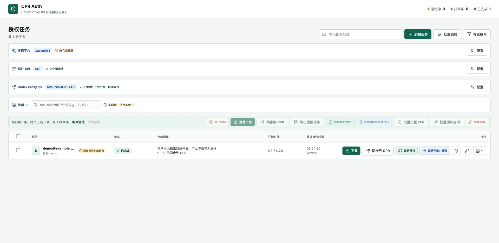

# CPR Auth

面向 [Codex Proxy RS](https://github.com/aocuan/codex-proxy-rs) 的独立账号授权与同步控制台。

基于 [poxiao33/toSub2](https://github.com/poxiao33/toSub2)，从 [aocuan/toSub2](https://github.com/aocuan/toSub2) 的代码历史继续开发。保留原作者的 MIT 许可与版权声明。CPR Auth 是社区项目，与 OpenAI 无隶属关系。



## 第一版能力

- 复用上游邮箱登录、验证码、任务队列、恢复、重新授权与本地导出流程
- 通过 CPR 管理员 API Key 测试连接、读取分组与代理
- 手动同步单个或多个已完成任务；可开启新授权完成后自动同步
- 查询 CPR 后台导入结果，显示账号 ID；同步失败不重新执行登录
- 重复点击与进程重启保留同步记录；结果未知时停止自动提交，支持人工核对后关联或允许重试
- CPR Key 在服务端使用 AES-256-GCM 保存，不返回给前端，不写入浏览器存储

仅支持 CPR，不提供 Sub2API 上传或异常账号巡检。授权结果文件沿用上游的 sub2api JSON 格式作为内部中间产物，连接器只抽取 CPR 支持的 OAuth token 字段。

## 本地启动

需要 Node.js 22+、Python 3.10+。

```bash
npm ci
python3 -m venv .venv
.venv/bin/python -m pip install -r requirements.txt
TOSUB2_PYTHON="$PWD/.venv/bin/python" npm start
```

默认地址为 `http://127.0.0.1:4399`。Windows 可设置 `TOSUB2_PYTHON` 指向 `.venv\Scripts\python.exe`。默认数据目录为 `tmp/chatgpt-onboarding-console`，可用 `ONBOARDING_OUTPUT_ROOT` 改为持久化目录。

生产模式先执行 `npm run build`，再以 `NODE_ENV=production` 启动；生产服务仅提供构建产物，不提供 Vite 开发入口。

## Docker

```bash
cp .env.example .env
# 编辑 .env，设置至少 16 字符的独立访问密码
docker compose up --build -d
```

浏览器登录用户名为 `admin`，密码为 `CPR_AUTH_PASSWORD`。Compose 默认只发布到宿主机 `127.0.0.1:4399`，远程访问应通过 HTTPS 反向代理。非回环监听未配置足够长度的密码时服务拒绝启动。`/healthz` 只返回健康状态，不要求登录。

## 连接 CPR

1. 在 CPR 设置中生成管理员 API Key
2. 点击 Codex Proxy RS 工具栏右侧的「配置」，填写 CPR 服务根地址和 Key
3. 点击「读取配置」，选择分组与导入代理，再保存
4. 完成授权后点击「同步到 CPR」，或开启自动同步
5. 以任务行的 CPR 结果为准；授权完成本身不表示已入库

需要 CPR 提供 `/api/admin/accounts/import-tasks`、其详情接口、`/api/admin/account-groups/options`、`/api/admin/proxies` 和账号详情接口。对照开发基线为 `aocuan/codex-proxy-rs` 的 `b36b024c5561`，不按版本号假定其他发行版具有相同合同。

服务地址必须能从 CPR Auth 后端访问。容器内 `127.0.0.1` 指容器自身；两个容器部署时使用共同网络内的服务名。请求禁止跟随重定向，避免管理员 Key 被转发到其他地址。

选择分组会应用 CPR 的完整导入设置：启用账号、权重 1、继承并发上限、替换分组集合。不选分组时省略设置，已有账号保留原设置，新账号不分组。CPR 按上游身份匹配已有 OAuth 账号，本工具不提供任意 accountId 的强制 token 覆盖。

「CPR 导入出口代理」只控制 CPR 侧的凭据导入；本工具执行登录时使用任务自己的代理，两者需要分别配置。

## 结果未知与恢复

同步状态与连接配置保存在加密的 `cpr-state.enc` 中，配套密钥为同目录的 `cpr-key`，两者必须一起备份。密钥文件限制为当前用户读写；同机管理员或持有完整备份的人仍能解密。

- CPR 已返回任务 ID：重启后继续查询该任务，不重复提交
- CPR 明确拒绝或导入失败：检查配置后点击同步，仅重试导入
- 提交断网、结果无法解析、CPR 任务过期或丢失：显示结果未知，禁止盲重试
- 已确认入库：在任务中填写对应的 CPR 账号 ID，服务端核对平台与邮箱后关联
- 已确认未入库：显式勾选确认后解锁，再点击同步重新提交；判断错误仍可能导致重复更新

CPR 后台任务记录有保留期限且可能因 CPR 重启丢失，因此本工具不承诺跨服务的严格一次执行。重新授权会产生新凭据，成功后允许再次同步。

## 数据与边界

CPR Key 具有管理员权限，工具访问者应视为可信管理员。访问密码保护不是多用户权限系统。不要将服务明文开放到公网。

CPR 配置加密不等于全部上游产物都已加密：OAuth 输出、Session、恢复检查点仍沿用上游文件存储。数据目录及备份含敏感材料，应限制文件权限并按需删除任务；删除本地任务不会删除 CPR 账号。密码、2FA 与登录代理在 macOS 使用 Keychain、Windows 使用 DPAPI；Linux 使用 AES-256-GCM 并绑定账号邮箱，保存在数据目录的 `credentials/` 下。备份时必须同时保留密文和 `credential-key`；密钥丢失或损坏会拒绝读取和覆盖现有凭据，不会自动生成替代密钥。

CPR Auth 使用独立的系统凭据名称与目录，不读取或删除 toSub2 的系统凭据。首次接入需要重新提供登录资料；旧数据的自动迁移尚未实现。当前没有数据库，SQLite 与下游能力的评估见 [复用与持久化方案](docs/downstream-reuse.md)。

外部登录流程会受上游协议变化、代理及验证要求影响。本版本的自动化验证使用模拟授权和受控 CPR HTTP 服务，尚未完成真实账号授权、真实 CPR 入库或公网部署验收。验证范围见 [验证说明](docs/verification.md)。

## 开发与许可

```bash
npm run build
npm run check
npm run test:cpr
```

`test:cpr` 中的访问控制测试需要先构建前端。完整测试需要 `requirements.txt` 中的 Python 依赖，可通过 `TOSUB2_PYTHON` 指定解释器。

[LICENSE](LICENSE) 沿用 MIT；[CHANGELOG.md](CHANGELOG.md) 保留的是上游历史，不代表 CPR Auth 的发行记录。新增 CPR 连接实现、界面与测试由 aocuan 项目维护。
